<p align="center">
  <a href="README_EN.md">English</a> · <b>Русский</b>
</p>

<p align="center">
  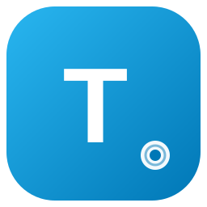
  <h1 align="center">TGGATE — Telegram Gate</h1>
  <p align="center">
    Панель управления Telegram-прокси: <b>Web Proxy</b> и <b>MTProto</b> через единый сервер <b>Telemt</b> —
    с ботом продаж, аналитикой, автопродлением и автообновлениями.
  </p>
  <p align="center">
    <a href="https://github.com/Therealwh/Web-Proxy-Telegram-Panel-TG-BOT/releases/latest"></a>
    <a href="LICENSE"></a>
    <a href="https://github.com/Therealwh/Web-Proxy-Telegram-Panel-TG-BOT/actions/workflows/ci.yml"></a>
    
    
  </p>
</p>

<p align="center">
  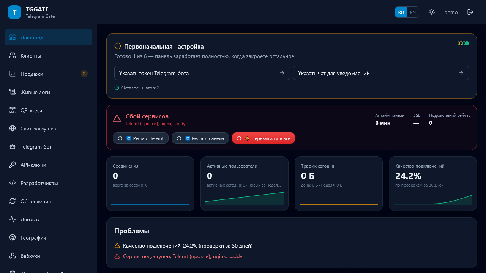
</p>

<p align="center"><sub>
  <a href="docs/SCREENSHOTS.md">📸 Все 20 скриншотов панели</a>
</sub></p>

---

## 📑 Содержание

- [✨ Возможности](#-возможности)
- [📸 Скриншоты](#-скриншоты)
- [⚡ Быстрая установка](#-быстрая-установка)
- [🤖 Telegram-бот продаж](#-telegram-бот-продаж)
- [🛠 Управление](#-управление)
- [🔄 Обновления](#-обновления)
- [🌐 Протоколы](#-протоколы)
- [🔧 Troubleshooting](#-troubleshooting)
- [❤️ Поддержать проект](#-поддержать-проект)
- [📚 Документация](#-документация)

## ✨ Возможности

### Продажи

| | |
|---|---|
| 🤖 **Бот продаж** | Тарифы, 5 способов оплаты (баланс, CryptoBot, ЮKassa, ⭐ Stars, карта), кабинет с кнопками подключения, автопродление, рефералка, бесплатный тест |
| 📊 **Аналитика** | Выручка по дням, топ тарифов, конверсия теста, новые клиенты, воронка |
| 🪪 **Пользователи бота** | Все, кто писал боту (не только покупатели): выдача прокси, пополнение баланса, рассылка — прямо из панели |

### Управление прокси

| | |
|---|---|
| 👥 **Клиенты** | Квоты, срок действия, лимиты IP и скорости, Ad Tag, выбор протоколов, массовые действия, **пагинация** с сохранением выделения между страницами |
| 📜 **Журнал действий** | Кто и когда менял данные — пишется автоматически, фильтры, поиск, экспорт CSV |
| 🌍 **География** | Карта мира, флаги, рейтинг стран по подключениям |
| 📡 **Движок** | Телеметрия Telemt: ME-пул, NAT/STUN, гейты, апстримы, TLS-отпечатки |
| 📈 **Живые логи** | Подключения в реальном времени, фильтры, распознавание устройств, экспорт |
| 🔑 **QR-коды** | Web и MTProto, PNG/SVG, кастомизация, публичные страницы, статистика сканов |

### Эксплуатация

| | |
|---|---|
| 🧭 **Мастер настройки** | Карточка на дашборде перечисляет незакрытые шаги и исчезает, когда всё готово |
| 🩺 **Проверка системы** | Диагностика по кнопке: версии, сервисы, ресурсы, целостность БД, бэкапы, безопасность |
| 🔄 **Обновления** | Автообновления с живым прогрессом и откатом, смена домена из панели |
| 💾 **Бэкапы** | Автоматические, с retention, экспорт и восстановление в файл, отправка в Telegram |
| 🔔 **Уведомления** | Алерты в Telegram: падение сервисов, деградация DC, кончившийся диск, новый клиент |
| 🎨 **Интерфейс** | Тёмная и светлая темы, акцентные цвета, RU/EN, живая карта |

### Интеграции

| | |
|---|---|
| 🔌 **Публичный API** | API-ключи с уровнями прав, Swagger UI, 13 эндпоинтов |
| 🪝 **Вебхуки** | 8 событий с подписью HMAC-SHA256, управление из панели, кнопка «Тест», статус доставки |
| 📄 **Сайт-заглушка** | Файловый менеджер, шаблоны, SEO — домен выглядит как обычный сайт |
| 📱 **Веб-кабинет клиента** | Продление и оплата прямо в браузере, даже если клиент удалил бота |

- **Панель TGGATE**: https://github.com/Therealwh/Web-Proxy-Telegram-Panel-TG-BOT
- **Telemt** (прокси-сервер): https://github.com/telemt/telemt

## 📸 Скриншоты

<details open>
<summary><b>Основные разделы</b></summary>

| Дашборд | Клиенты |
|---|---|
|  | 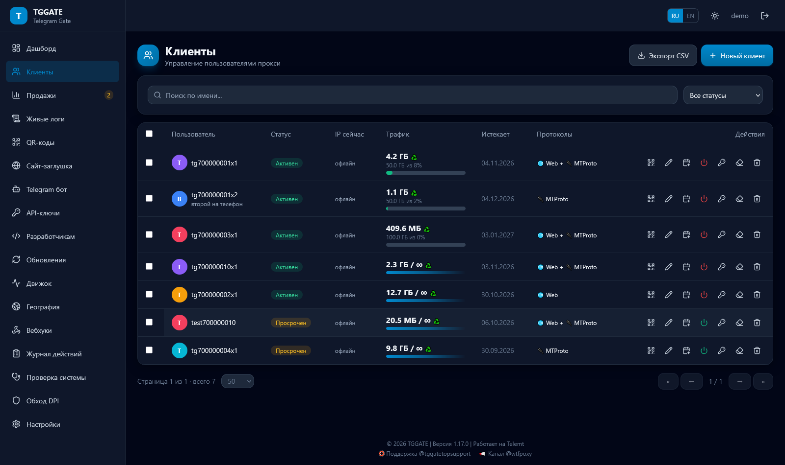 |

| Продажи | Живые логи |
|---|---|
| 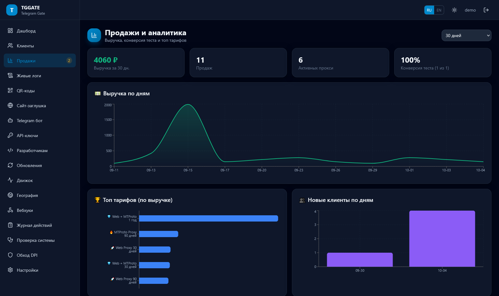 | 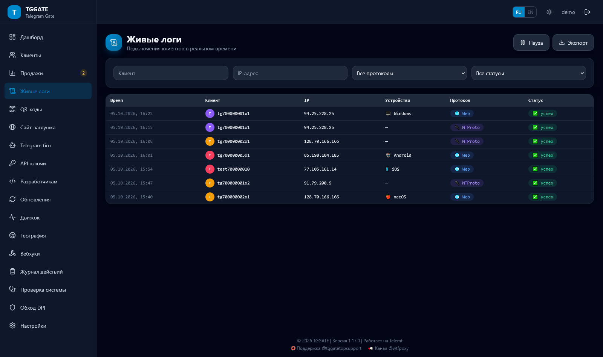 |

| География | Telegram-бот |
|---|---|
| 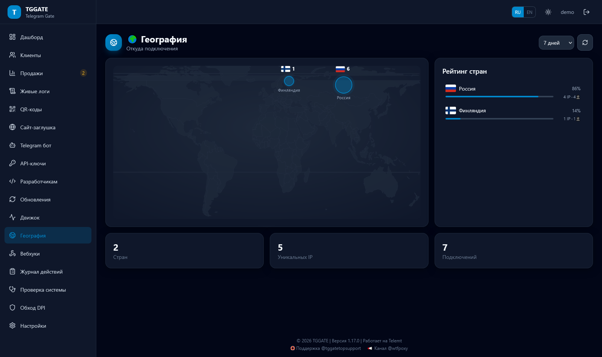 | 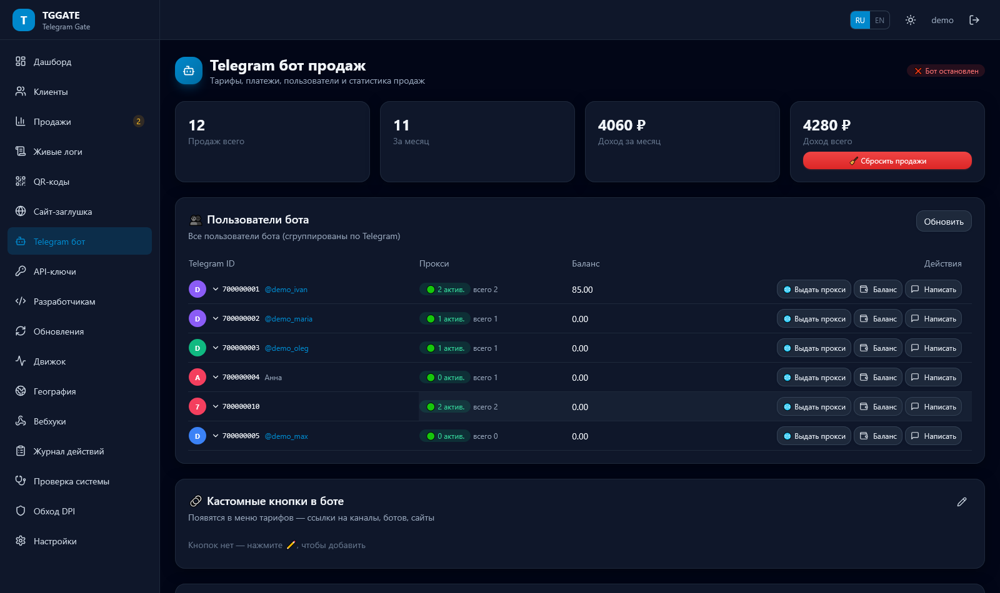 |

</details>

<details>
<summary><b>Эксплуатация и настройки</b></summary>

| Проверка системы | Журнал действий |
|---|---|
| 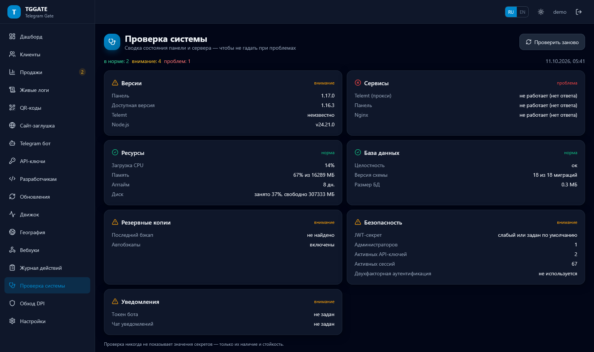 | 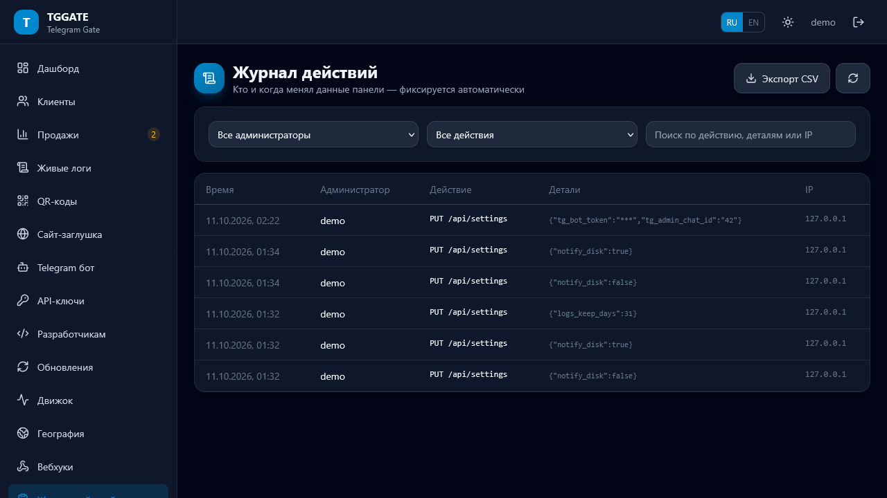 |

| Настройки | Вебхуки |
|---|---|
| 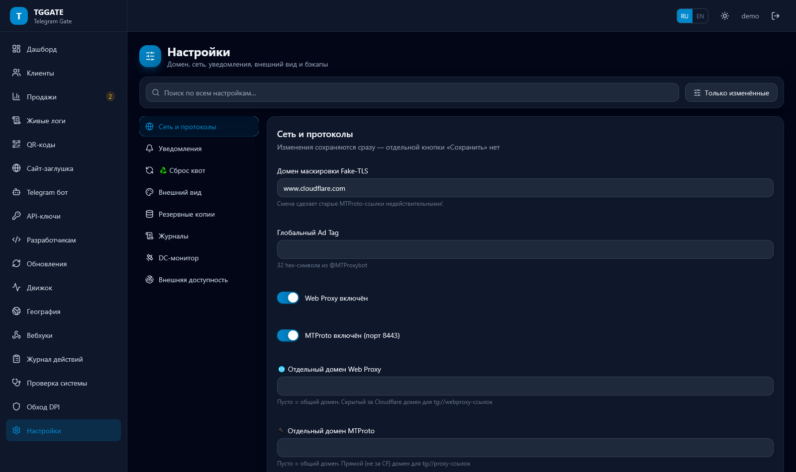 | 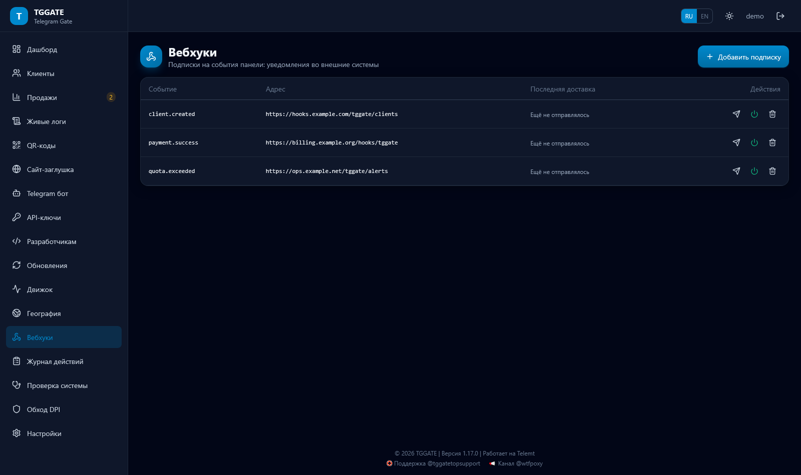 |

| Обновления | Движок Telemt |
|---|---|
| 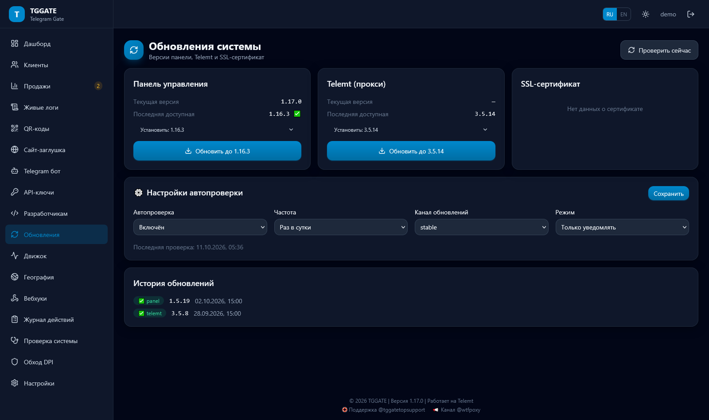 | 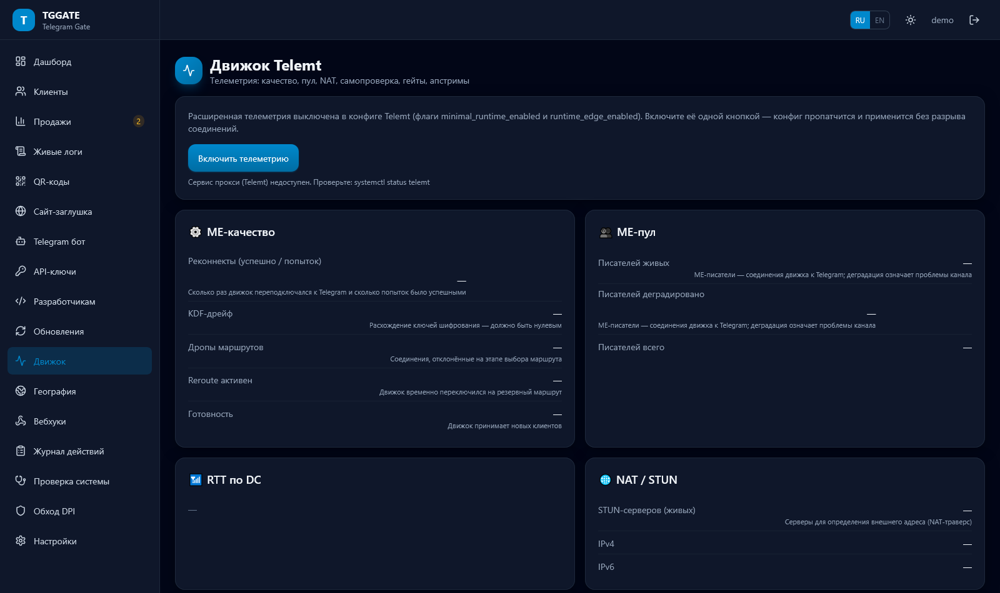 |

</details>

<details>
<summary><b>Остальные разделы</b></summary>

| QR-коды | Сайт-заглушка |
|---|---|
| 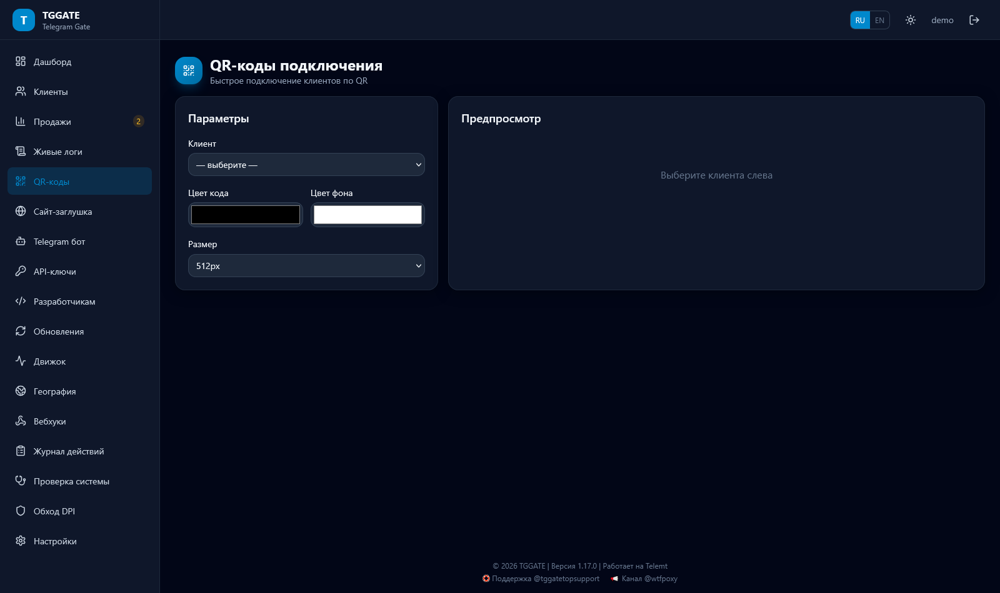 | 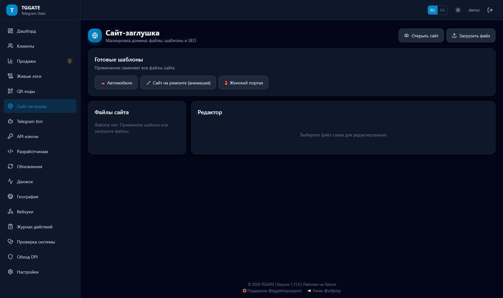 |

| API-ключи | Для разработчиков |
|---|---|
| 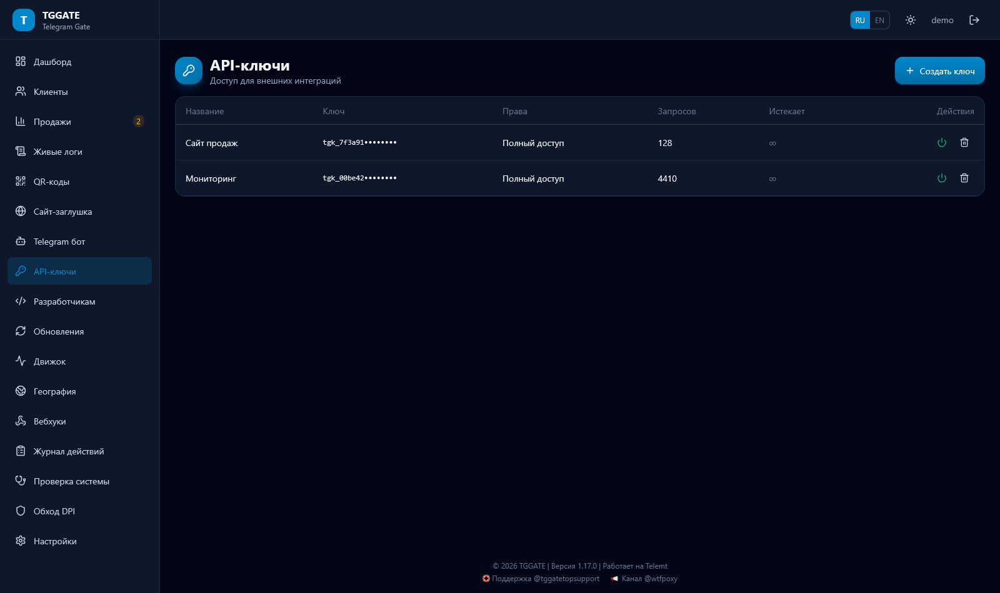 | 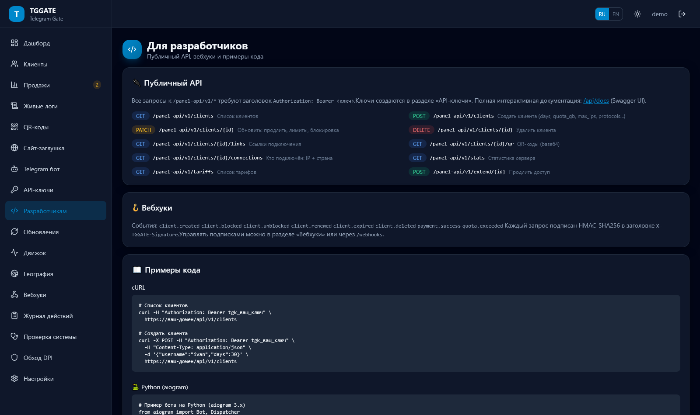 |

| Обход DPI | Публичный статус |
|---|---|
| 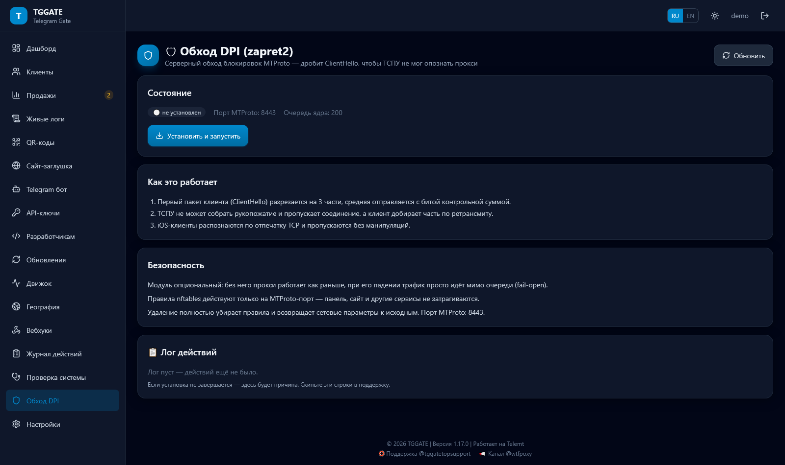 | 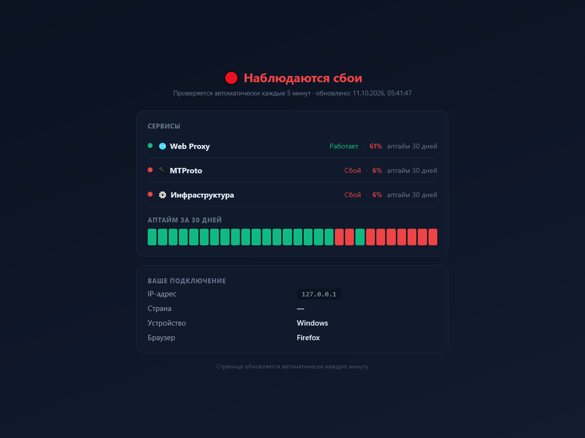 |

</details>

Полная галерея — в [docs/SCREENSHOTS.md](docs/SCREENSHOTS.md).

## ⚡ Быстрая установка

Требования: чистый VPS с **Ubuntu 22.04 / 24.04**, root-доступ, домен с
A-записью на IP сервера.

```bash
apt-get -o DPkg::Lock::Timeout=600 update && \
apt-get -o DPkg::Lock::Timeout=600 install -y curl ca-certificates git && \
bash -c "$(curl -fsSL --proto '=https' --tlsv1.2 \
  https://raw.githubusercontent.com/Therealwh/Web-Proxy-Telegram-Panel-TG-BOT/main/install.sh)"
```

Установщик интерактивно спросит:

| Параметр | Описание |
|---|---|
| 🌐 Домен | Например, `proxy.example.com` (A-запись должна указывать на сервер) |
| 📧 Email | Для SSL-сертификата Let's Encrypt |
| 👤 Логин | Логин администратора (латиница) |
| 🔑 Пароль | Минимум 8 символов, буквы + цифры |
| 🌍 IP | Внешний IP (определяется автоматически) |

После установки вы получите адрес панели с секретным путём:
`https://ваш-домен/cp-xxxxxx/`

Дальше пройдите шаги из карточки **«Первоначальная настройка»** на дашборде —
панель подскажет, что осталось настроить.

## 🤖 Telegram-бот продаж

Тарифы с ценами и лимитами (IP, трафик), выдача ссылок после оплаты,
уведомления админу, статистика продаж. Админка в самом боте: `/admin` —
дашборд, подтверждение платежей, рассылки.

**Способы оплаты:** баланс, CryptoBot, ЮKassa, ⭐ Telegram Stars
(автоконверт цены по курсу), карта админа (СБП) с приёмом чеков.

**Личный кабинет:** все прокси клиента — под каждым кнопки
«🌐 Подключить ВЕБ прокси» / «🔌 Подключить MTProto прокси» (по купленным
протоколам) и «♻️ Продлить». Продление прокси с двумя протоколами
(например, тестового) предлагает выбор: только Web / только MTProto / оба.
**Автопродление с баланса** — включается клиентом одним нажатием.
Плюс пополнение баланса, рефералка и пошаговые инструкции «📱 Как подключить».

**Веб-кабинет:** ссылка `/p/{токен}` приходит с каждой покупкой — клиент
видит прокси и продлевает с оплатой прямо в браузере, даже если удалил бота.

Обязательная подписка на канал (вкл/выкл), тестовый доступ на 3 часа.

**Надёжность:** автобэкап базы в Telegram, мониторинг MTProto/Web/Telemt
с алертами в бот, публичная страница статуса, iOS-подсказки при подключении.

<details>
<summary><b>📊 Возможности панели подробнее</b></summary>

### Дашборд
Нагрузка CPU/RAM/сеть в реальном времени (WebSocket), счётчики клиентов
и подключений, трафик за день/неделю/месяц, статусы сервисов, срок SSL,
живой график трафика, таймлайн событий и кнопки рестарта сервисов.

### Клиенты
Квоты трафика с прогресс-баром, дата истечения, лимит IP, ограничение
скорости, Ad Tag, выбор протоколов (Web Proxy / MTProto), CSV
импорт/экспорт, массовое создание и массовые действия, перевыпуск ссылок.

### Живые логи
Подключения в реальном времени, фильтры по клиенту/IP/протоколу,
устройства клиентов (Windows/macOS/iOS/Android), цветовая разметка
(✅/❌/⚠️), экспорт за период.

География пишется при сборе логов, а не вычисляется при просмотре:
страна, город, автономная система и её оператор. Благодаря этому логи
можно фильтровать и группировать по стране, а данные пригодны для
аналитики; всё это входит и в CSV-экспорт.

### Telegram-бот
Личный кабинет с расходом трафика и остатком, понятной подсказкой
при блокировке или истечении, кнопкой отправки всех ссылок обычным
текстом (их можно скопировать и вставить вручную) и быстрым пополнением
счёта прямо с карточки прокси.

### QR-коды
QR для Web Proxy и MTProto, PNG/SVG, кастомизация цветов и размера,
публичная страница `/qr/{id}`, статистика сканирований, отправка в Telegram.

### Сайт-заглушка
Встроенный файловый менеджер и редактор кода, 4 готовых шаблона,
SEO-поля, предпросмотр. Домен выглядит как обычный сайт.

Один из шаблонов — **«Танчики»**, браузерная аркада в стиле Battle City:
15 уровней возрастающей сложности, редактор карт с восемью слотами и
обменом кодами карт, 6 видов бонусов, 4 типа врагов, полноэкранный
режим и онлайн-таблица рекордов. Ничего не подгружается извне, поэтому
сайт открывается даже без интернета.

#### Яндекс.Метрика и Вебмастер

Счётчики и верификация живут в отдельном файле `analytics.html`
и переживают обновление шаблона: при применении нового шаблона панель
сохраняет файл и подставляет обратно в `index.html`.

Порядок подключения:

1. Откройте **Сайт → Файлы → `analytics.html`**.
2. Для верификации Вебмастера вставьте свой код в `content="..."`
   и снимите комментарий со строки.
3. Для Метрики замените `00000000` на номер счётчика (два места)
   и снимите комментарий с блока.
4. Сохраните — `index.html` пересоберётся автоматически.

Счётчик сработает сразу: сайт отдаётся движком как чистая статика,
ограничений на внешние скрипты нет. Информер и Вебвизор в заготовке
отключены — декоративному сайту запись сессий посторонних не нужна.

Уровни строятся по трём типам симметрии — обычной, широкой и
диагональной, — поэтому поле выглядит по-разному даже при одинаковом
объёме описания, и повторов среди уровней нет.

Шаблон полностью закрыт по SEO: `title` и `description` подобраны под
поисковые запросы, есть Open Graph для красивого превью в мессенджерах,
картинка обложки, `robots.txt` и разметка Schema.org (`VideoGame`,
`FAQPage`, `PlayAction`) — по ней поисковики понимают, что на странице
игра, и могут показать её в результатах.

Рекорды хранятся в панели: эндпоинт `/panel-api/game/scores` публичный,
без авторизации (иначе посетитель заглушки ничего не записал бы), но с
ограничением частоты, валидацией ника и очков и обрезкой таблицы до
200 строк. IP посетителей не сохраняется — он нужен только для счётчика
частоты.

### Публичный API
API-ключи с разделением прав, Swagger UI, вебхуки с HMAC-подписью,
примеры для Python и Node.js. Создание клиентов со всеми лимитами
(IP, скорости, трафик), ссылки, QR, продление.

</details>

## 🛠 Управление

```bash
sudo TGGATE
```

Меню: статус сервисов, старт/стоп/рестарт, логи, смена логина/пароля,
смена домена, обновления, бэкап/восстановление, удаление.

## 🛡 Защита и отказоустойчивость

Настройки собраны в одном разделе (**Настройки → Защита и отказоустойчивость**).
Большинство из них применяется с перезапуском движка — об этом сказано на карточке.

### Fake TLS (MTProto)
Панель генерирует ссылки Fake TLS (`ee`) **в дополнение** к обычным (`dd`),
а не вместо них. Уже выданные клиентам ссылки не меняются и продолжают
работать — клиент просто получает вторую ссылку и выбирает, что работает
у его оператора.

Ссылка `ee` появляется только после проверки домена маскировки: он должен
поддерживать **TLS 1.3** и резолвиться в **IP этого сервера**. Если проверка
не пройдена, `ee`-ссылка не показывается вовсе — вместо неё клиент видит
рабочую `dd`. Проверка выполняется раз в 6 часов и после смены домена маскировки.

> Fake TLS относится только к MTProto. Web Proxy уже работает поверх
> настоящего HTTPS и в нём не нуждается.

### Запасные транспорты Web Proxy
Панель может включить перебор транспортов: клиент пробует их по порядку,
пока не найдёт рабочий (`https-lanes`, `websocket`, `websocket-lanes`).
Запасным вариантом всегда остаётся `https` — **Telegram iOS поддерживает
только его**, и его смена сломала бы весь iOS.

Перебор выключен по умолчанию. Учтите: параметр не поддерживает hot-reload,
поэтому после применения панель перезапускает движок.

### Политика SNI
Настраивается, что движок отвечает клиенту, пришедшему с чужим SNI:

| Поведение | Описание |
|-----------|----------|
| `drop` | Молча закрыть соединение (по умолчанию) |
| `mask` | Перенаправить на маску — максимальная маскировка |
| `accept` | Принять как валидный (слабее защита от пробинга) |
| `reject_handshake` | Отказать рукопожатием, как nginx без такого домена |

### Живой сайт за прокси-доменом (selfmask)
Вместо заглушки панели можно отдавать настоящий сайт: обычные запросы
к прокси-домену перенаправляются на локальный бэкенд. Указывается **приватный
адрес** (например `127.0.0.1:8099`) — движок принимает только `http://`
с IP-литералом приватной или локальной сети.

### Запасные домены
Дополнительные домены работают на том же IP и том же секрете клиента.
Если основной домен заблокируют, клиент переключается на резервный.

Ограничения движка, о которых стоит знать заранее:
- максимум **8 доменов**;
- каждому домену нужны собственные профили клиентов, а всего профилей
  допускается **32** — каждый новый домен умножает их число. Панель
  предупредит об этом до применения;
- домен должен **уже указывать на IP сервера**, иначе Let's Encrypt
  не выпустит сертификат и подключение не заработает.

### Блокировка IP и подсетей
Список адресов и подсетей в формате CIDR. Правила применяются двумя
механизмами: `deny` в Nginx для веб-прокси и наборы nftables для порта
MTProto — пакеты отсекаются до попадания в движок.

**Панель и SSH под блокировку не попадают:** у панели собственный location,
у MTProto свой порт. Иначе заблокированный адрес потерял бы ещё и доступ
к админке.

Слишком широкие подсети (IPv4 шире `/8`, IPv6 шире `/16`) отклоняются —
иначе один неверно введённый адрес отрезал бы доступ к прокси огромной
части клиентов.

### Резервный маршрут к Telegram (WARP)

Если доступ с IP сервера к адресам Telegram DC закрывается, клиенты
подключаются к прокси, но **ничего не грузится**: обрыв на участке
«сервер → Telegram». Перезапуск движка не помогает — маршрут тот же,
и DC-монитор такое состояние видит, но обойти не может.

Резерв заворачивает в туннель Cloudflare **только трафик к дата-центрам
Telegram**. Весь остальной трафик (панель, сайты, обновления) идёт
напрямую и не зависит от Cloudflare.

Выключено по умолчанию, включается одним кликом
(**Настройки → Защита → Резервный маршрут**).

Как пользоваться:
1. Поставить клиент Cloudflare WARP на сервер и зарегистрировать аккаунт.
2. Включить резерв в панели — добавятся правила маршрутизации к подсетям Telegram.
3. Если клиенты жалуются «подключается, но не грузит» — включить.
4. Если всё работает и без него — держать выключенным: WARP добавляет
   задержку и не нужен, пока нет проблемы.

Если правила включены, а туннель отключён — панель покажет это отдельным
предупреждением: такой маршрут хуже отсутствия маршрута, трафик к
Telegram уходит в никуда.

Вручную:
```bash
sudo bash /opt/tggate/scripts/warp.sh status|enable|disable
```

### Лимиты памяти и CPU
Движок ограничивается через systemd drop-in, который переживает обновления
движка. Лимиты считаются от фактической памяти сервера, а не задаются
мегабайтами вручную.

`MemoryMax` ограничивает **только процессы Telemt**: при его достижении
перезапустится движок, а панель, Nginx и Caddy останутся доступны. Без
потолка OOM-killer выбирает жертву наугад и может убить панель.

Применить: **Настройки → Защита → Лимиты памяти и CPU**, либо вручную:
```bash
sudo bash /opt/tggate/scripts/telemt-limits.sh
```

Текущее потребление и процент от потолка видны в **Диагностике**.

## 🔄 Обновления

### Автоматические
Панель проверяет обновления с заданной частотой
(Настройки → Обновления). Каналы: stable / beta / latest.

### Ручные
- Через панель: **Обновления → Обновить панель / Обновить Telemt**
- Через консоль: `sudo TGGATE` → пункты 8/9/10

```bash
# или напрямую, с указанием версии
sudo bash /opt/tggate/scripts/update-panel.sh v1.17.0
```

### Откат
При неудачном обновлении панель автоматически откатывается на бэкап.
Бэкапы хранятся в `/var/backups/tggate/`, ротация оставляет последние три.

## 🌐 Протоколы

| Протокол | Порт | Ссылка |
|---|---|---|
| Web Proxy | 443 (через домен) | `tg://webproxy?server=...&secret=dd...` |
| MTProto (Fake TLS) | 8443 | `tg://proxy?server=...&port=8443&secret=ee...` |

## 🔧 Troubleshooting

| Проблема | Решение |
|---|---|
| Панель не открывается | Проверьте секретный путь и `sudo TGGATE` → статус |
| SSL не выпускается | Убедитесь, что A-запись домена указывает на IP сервера |
| MTProto не подключается | `sudo ufw status` — порт 8443 должен быть открыт |
| Telemt упал | `journalctl -u telemt -n 100` |
| Непонятно, что сломано | **Проверка системы** в панели — собирает всё в одном месте |

## ❤️ Поддержать проект

TGGATE развивается одним человеком в свободное время. Если панель приносит
вам доход или просто нравится — поддержите разработку любой суммой 🙏
Каждое пожертвование идёт на серверы, домены и новые функции.

**USDT — TRC-20**
```
TGWtYdfLEVEVXScaE4Ut7ornk1A3CXCCfe
```

**TRX — TRON**
```
TGWtYdfLEVEVXScaE4Ut7ornk1A3CXCCfe
```

**USDT — TON**
```
UQCGYVM9hg2JcqnEQpTPibPxHUuSOB03zhaSE8Yn-C2aHlH-
```

**GRAM — TON**
```
UQCGYVM9hg2JcqnEQpTPibPxHUuSOB03zhaSE8Yn-C2aHlH-
```

**BNB — Smart Chain (BEP-20)**
```
0xde5a28A77359cdCf32666Db8Aae5f5Bb13c5f886
```

> Спасибо! 💙

## 📚 Документация

- [Скриншоты панели](docs/SCREENSHOTS.md)
- [Установка](docs/INSTALL.md)
- [API панели](docs/API.md)
- [Публичный API](docs/API_PUBLIC.md)
- [Telegram-бот](docs/BOT.md)
- [Telemt и протоколы](docs/TELEMT.md)
- [QR-коды](docs/QR_CODES.md)
- [Сайт-заглушка](docs/WEBSITE.md)
- [Для разработчиков](docs/DEVELOPERS.md)

## 📄 Лицензия

MIT © 2026 TGGATE