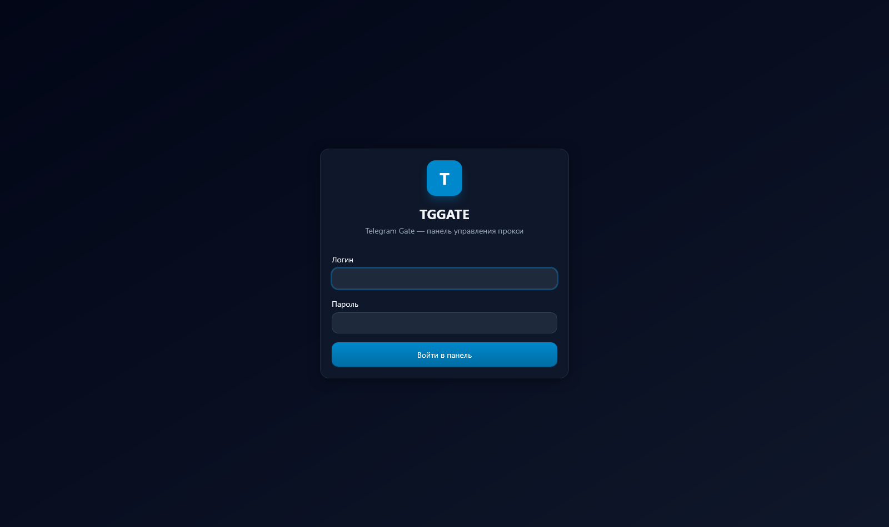
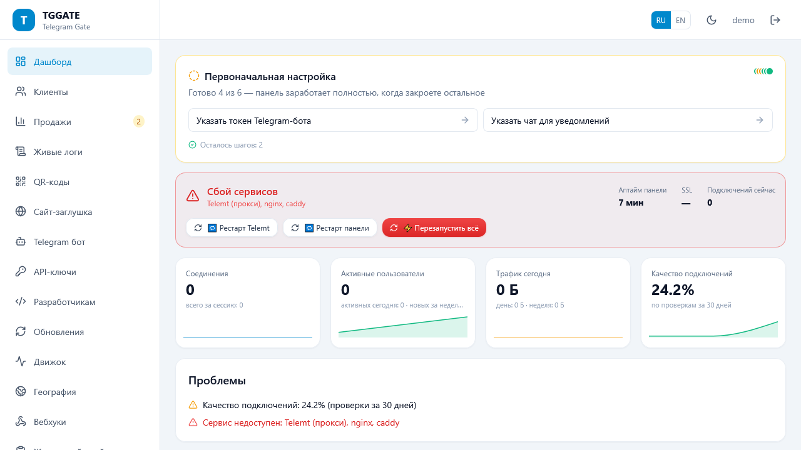

# 📸 Скриншоты панели

Все снимки сделаны с **v1.17.0** на демо-стенде с реальными данными.
Тёмная тема — основная, светлая показана отдельным кадром.

## Вход

## Дашборд

Живая нагрузка (CPU/RAM/сеть) через WebSocket, счётчики, трафик, статус
сервисов и срок SSL. Сверху — карточка первоначальной настройки: она
перечисляет незакрытые шаги и **исчезает сама**, когда всё готово.

Светлая тема

## Клиенты

Квоты с прогресс-баром, срок действия, лимиты IP и скорости, протоколы.
Массовые действия и пагинация: выбранные клиенты сохраняются при переходе
между страницами.

## Продажи и аналитика

Выручка по дням, топ тарифов, конверсия теста, новые клиенты за период.

## Живые логи

Подключения в реальном времени, фильтры по клиенту, IP, протоколу и
статусу, распознавание устройств, экспорт CSV за период.

## QR-коды

Генерация QR для Web Proxy и MTProto, PNG/SVG, кастомизация цветов и
размера, публичные страницы, статистика сканирований.

## Сайт-заглушка

Файловый менеджер и редактор, готовые шаблоны, SEO-поля и предпросмотр.

## Telegram-бот

Админка продаж: статистика, тарифы, пользователи бота, выдача прокси и
баланса, рассылки.

## API-ключи

Ключи с разделением прав (read / write / full), ограничением по IP и сроку
действия. Значение показывается один раз при создании.

## Для разработчиков

Документация публичного API, список событий вебхуков, примеры на Python и
Node.js, ссылка на Swagger UI.

## Обновления

Версии панели, Telemt и SSL-сертификата, автопроверка, канал обновлений и
история обновлений с живым прогрессом.

## Настройки

Две колонки: категории слева, поля справа. Поиск по всем настройкам сразу —
по подписи, по значению и по названию категории. Изменения сохраняются сразу
по каждому полю, видно, что сохранилось и что можно вернуть. Опасные
действия вынесены в отдельную зону.

## Публичный статус

Страница статуса проекта без авторизации — можно дать пользователям.

## География

Карта мира с распределением подключений по странам, флаги, рейтинг стран,
фильтр по диапазону дат.

## Движок Telemt

Телеметрия движка: качество ME-пула, NAT/STUN, самопроверка, гейты,
апстримы, таблица TLS-отпечатков.

## Вебхуки

Подписки на события панели, кнопка «Тест» с немедленным результатом и
статус последней доставки по каждой подписке.

## Журнал действий

Кто и когда менял данные панели: фильтры по администратору и типу действия,
поиск, пагинация и экспорт CSV. Пишется автоматически на каждый изменяющий
запрос.

## Проверка системы

Диагностика по кнопке: версии, сервисы, ресурсы, целостность базы,
свежесть бэкапов, безопасность и уведомления. Значения секретов не
показываются — только факт наличия и стойкость.

## Обход DPI

Установка, настройка и управление модулем zapret2, журнал очереди.

